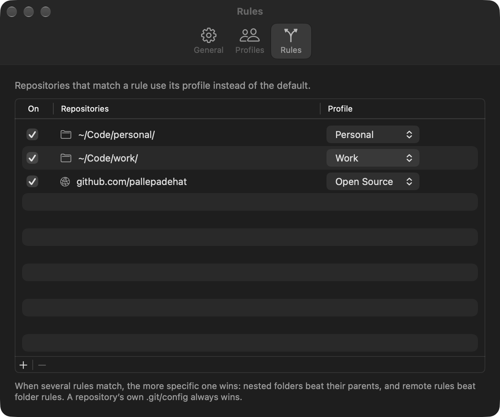

<p align="center">
  
</p>

<h1 align="center">SwitchMyGit</h1>

<p align="center">
  The right Git identity in every repository. A small menu bar app for anyone who commits as more than one person.
</p>

<p align="center">
  <a href="https://github.com/Pallepadehat/SwitchMyGit/actions/workflows/ci.yml"></a>
  
  
  <a href="LICENSE"></a>
</p>

<p align="center">
  
</p>

## Features

**Switch in one click**
- Pick your default identity, such as Personal or Work, from the menu bar.
- The menu always shows what Git really uses, even if something else changed it.

**Automatic rules**
- Assign a profile to a folder: everything in `~/Code/work` commits as Work.
- Or to a remote: every repository on `github.com/acme` commits as Work, wherever it lives.
- Nested folders work as you'd expect. The most specific rule wins.

**Check any repository**
- Choose a folder and see which identity your next commit will use, and why.

**SSH keys per profile**
- Optionally pick a key for each profile, so pushes authenticate with the right account.

**Safe and invisible**
- Rules are written into Git's own configuration, so they work in every terminal and editor, even when the app isn't running.
- `~/.gitconfig` is backed up before every change, and your other settings are never touched.

## Install

You need a Mac on **macOS 27 or later**. Paste this into Terminal:

```sh
curl -fsSL https://raw.githubusercontent.com/Pallepadehat/SwitchMyGit/main/install.sh | bash
```

It downloads the latest release, puts SwitchMyGit in your Applications folder (replacing an older copy), and opens it. Run the same command again to update.

SwitchMyGit lives in the menu bar. On first launch, Settings opens so you can add your profiles and turn it on.

<details>
<summary><b>Or use the .dmg</b></summary>
<br>

Download **SwitchMyGit.dmg** from the [latest release](https://github.com/Pallepadehat/SwitchMyGit/releases/latest), open it and drag SwitchMyGit into Applications.

Releases aren't notarized by Apple yet, so macOS blocks the first launch. Clear the download flag once:

```sh
xattr -dr com.apple.quarantine /Applications/SwitchMyGit.app
```

The install script does this for you. It's [short and readable](install.sh), if you'd like to check it first.

</details>

<details>
<summary><b>Uninstall</b></summary>
<br>

First open **Settings → General** and switch off **Manage Git identity**. This restores your `~/.gitconfig`. Then quit SwitchMyGit from its menu and run:

```sh
rm -rf /Applications/SwitchMyGit.app ~/.config/switchmygit "$HOME/Library/Application Support/SwitchMyGit"
defaults delete com.pallepadehat.SwitchMyGit
```

</details>

### Build it yourself

You need **Xcode 27 or later**.

```sh
git clone https://github.com/Pallepadehat/SwitchMyGit.git
cd SwitchMyGit
open MacGitSwitcher.xcodeproj    # then press ⌘R
```

Or build from the command line with `./scripts/build.sh`.

Builds work without an Apple developer team. To sign with yours, copy `Config/Local.xcconfig.example` to `Config/Local.xcconfig` and add your team ID. That file is git-ignored.

## Privacy

SwitchMyGit makes no network requests and collects nothing. It never reads or copies your SSH keys; it only stores their paths. Your profiles are saved locally in `~/Library/Application Support/SwitchMyGit`.

The app isn't sandboxed, because the sandbox doesn't allow editing `~/.gitconfig` or running `git`.

## How it's built

| Folder | What's inside |
| --- | --- |
| [`Packages/SwitchMyGitKit`](Packages/SwitchMyGitKit) | All the logic: profiles, rules, the Git client, and safe config writing. Pure Swift with no UI, and fully tested against real Git. |
| [`MacGitSwitcher/App`](MacGitSwitcher/App) | The app entry point and `AppState`, which the views read from. |
| [`MacGitSwitcher/Features`](MacGitSwitcher/Features) | The menu bar menu, the Settings tabs and Check Repository. |
| [`scripts`](scripts) | Building, packaging and releasing, plus `generate-icons.swift`, which draws the app icon. |
| [`install.sh`](install.sh) | The one-command installer. |

Curious how it works under the hood? See [docs/ARCHITECTURE.md](docs/ARCHITECTURE.md).

## Contributing

Contributions are very welcome. Start with [CONTRIBUTING.md](CONTRIBUTING.md).

## License

[MIT](LICENSE) © 2026 Patrick Jakobsen
